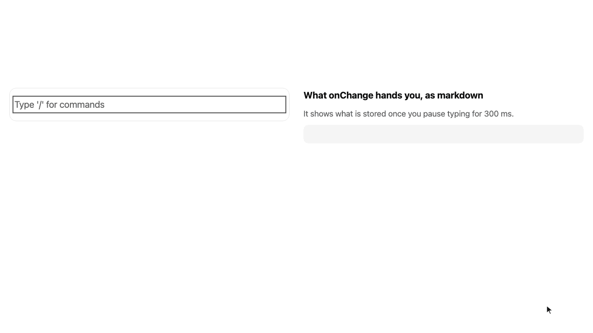

# Quoin

**Blocks on screen. Markdown on disk.**

Quoin is a block editor for React that keeps every block as readable markdown inside a typed array you hold in your own state. Writers get live formatting, a slash menu and drag handles; you get a document you can save, diff in git or hand to an LLM without a conversion step.

[](https://www.npmjs.com/package/quoin-editor) [](https://github.com/AmineSeboui/quoin-editor/actions/workflows/ci.yml) [](LICENSE)

[Live demo](https://amineseboui.github.io/quoin-editor/) | [Docs](https://amineseboui.github.io/quoin-editor/docs/getting-started/) | [Changelog](CHANGELOG.md)



- **Live formatting, markdown on disk.** Type `**bold**` or `# ` and see bold text or a heading; the block stores the markdown. Blocks you never edit are never rewritten (`src/engine/blocks/codec.test.ts`).
- **Typed blocks you control like an input.** A document is `QuoinBlock[]`, plain JSON, passed as `blocks` and returned through `onChange`, so saving, versioning and validation stay in your code.
- **Notion-style UI included, MIT.** Slash menu, bubble toolbar, block menu, drag handles, a mobile toolbar and a shortcuts dialog, with no account and no paid tier.
- **Custom blocks as plain React.** `defineBlock` takes an editor and a preview component; no schema language to learn.
- **Accessible, with tested keyboard and screen reader support.** In CI, axe runs over the canvas and its menus in light and dark mode (`e2e/tests/canvas/a11y.spec.ts`), a document is written with the keyboard alone (`keyboard-only.spec.ts`), and moves and deletions are announced (`shortcuts.spec.ts`). [What is not checked yet](https://amineseboui.github.io/quoin-editor/docs/accessibility/#what-is-not-checked-yet).

## Install

```bash
npm install quoin-editor
```

React 18.2 or 19, TypeScript 5.4 or later. Tailwind is optional, v3 and v4 both work. The npm tarball is about 2.0 MB, ESM and CommonJS with their sourcemaps; a page loads only the entries it imports.

## Quickstart

```tsx
import { useState } from 'react';
import { BlockCanvas, type QuoinBlock } from 'quoin-editor';
import 'quoin-editor/styles.css';

export function Editor() {
  const [blocks, setBlocks] = useState<QuoinBlock[]>([]);
  return <BlockCanvas blocks={blocks} onChange={setBlocks} />;
}
```

What `onChange` hands you, and what you store:

```json
[
  { "id": "a1", "type": "MARKDOWN", "data": { "markdown": "# Release notes" } },
  { "id": "b2", "type": "MARKDOWN", "data": { "markdown": "- Faster **paste**" } },
  { "id": "c3", "type": "CALLOUT", "data": { "tone": "tip", "body": "Back up first." } }
]
```

## What ships

| Entry | What it adds |
| --- | --- |
| `quoin-editor` | The canvas: text, lists, tasks, quotes, callouts, toggles, dividers, code, images and files, with every menu and toolbar |
| `quoin-editor/table`, `/embed`, `/math`, `/toc`, `/mention`, `/emoji`, `/find`, `/stats` | Opt-in features, each its own entry; `quoin-editor/catalogue` adds them all |
| `quoin-editor/yjs`, `/presence` | Real-time co-editing through your own Yjs provider, and collaborators' carets |
| `quoin-editor/comments` | Comment threads anchored to text, kept in your store |
| `quoin-editor/ai` | Your model's answers streamed into the document; Quoin never calls a model |
| `quoin-editor/view`, `/diff`, `/docx` | Server rendering with no hooks, a diff of two versions, a Word export |
| `quoin-editor/headless`, `/engine` | The editor without the canvas UI, and the engine alone with no React |

## Why Quoin

Facts from the review in [#73](https://github.com/AmineSeboui/quoin-editor/issues/73) (2026-10-12) and from each project's own docs and repository, checked on 2026-10-23.

| | Quoin 1.0 | Tiptap 3 | BlockNote | Editor.js |
| --- | --- | --- | --- | --- |
| Stored document | Block array, markdown per text block | ProseMirror JSON or HTML | Block JSON | Block JSON |
| Markdown | The storage format | `@tiptap/markdown`, in beta | Export and import, documented as lossy | Not in its docs |
| Notion-style UI | Included, MIT | Notion-like template on a paid plan | Included | Toolbox and inline toolbar |
| Licence | MIT | MIT core, paid Pro extensions | MPL-2.0, `xl-*` packages GPL-3.0 or commercial | Apache-2.0 |
| Real-time collaboration | Yjs, opt-in entry | Yjs | Yjs | On its roadmap |
| Comments | Opt-in, your store | Paid plan | Built in, on Yjs or a thread store | Not in its docs |
| Framework | React | React, Vue, Svelte, vanilla | React | Vanilla JS |

Where the Quoin column comes from: storage in `src/engine/blocks/markdown-spec.ts`, untouched blocks kept in `src/engine/blocks/codec.test.ts`, the UI and licence in this repository, collaboration in `e2e/tests/canvas/presence.spec.ts`, comments in `e2e/tests/canvas/comments.spec.ts`.

## Learn more

- [The controlled contract](https://amineseboui.github.io/quoin-editor/docs/contract/): loading, autosave, discarding, undoing a deletion
- [Theming](https://amineseboui.github.io/quoin-editor/docs/theming/): `--quoin-` tokens, dark mode, cascade layers, Tailwind
- [Custom blocks](https://amineseboui.github.io/quoin-editor/docs/custom-blocks/) and [uploads](https://amineseboui.github.io/quoin-editor/docs/uploads/)
- [Extensions](https://amineseboui.github.io/quoin-editor/docs/extensions/): every opt-in feature, and writing your own
- [Collaboration](https://amineseboui.github.io/quoin-editor/docs/collaboration/), [comments](https://amineseboui.github.io/quoin-editor/docs/comments/) and [AI](https://amineseboui.github.io/quoin-editor/docs/ai/)
- [Server rendering](https://amineseboui.github.io/quoin-editor/docs/server-rendering/): read-only, `QuoinView`, `QuoinDiff`, `toDocx`
- [Accessibility](https://amineseboui.github.io/quoin-editor/docs/accessibility/): what each test suite checks, and what it does not yet
- [FAQ](https://amineseboui.github.io/quoin-editor/docs/faq/): the package name, stability, React versions

## The name

A quoin is the wedge a letterpress printer tightens to lock blocks of type into the frame, so nothing moves while the page is printed. Quoin does the same for blocks of markdown.

## Licence

MIT. Copyright (c) 2026 Amine Sboui. See [LICENSE](LICENSE).
