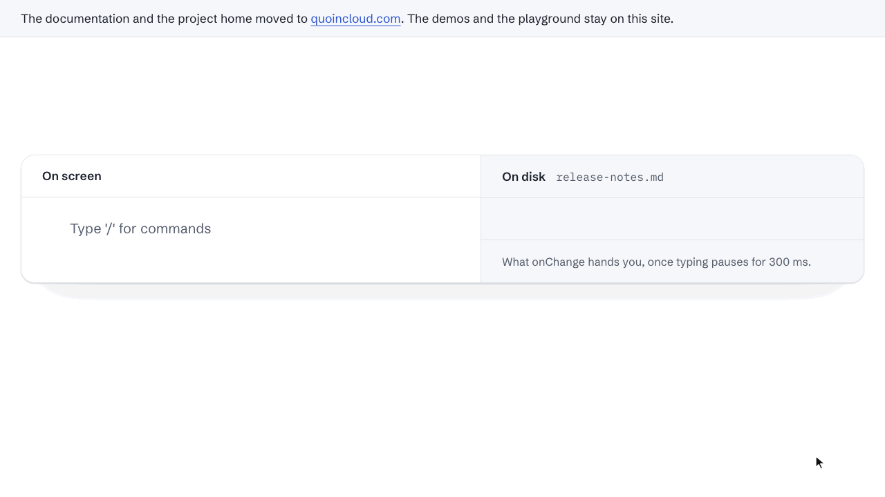
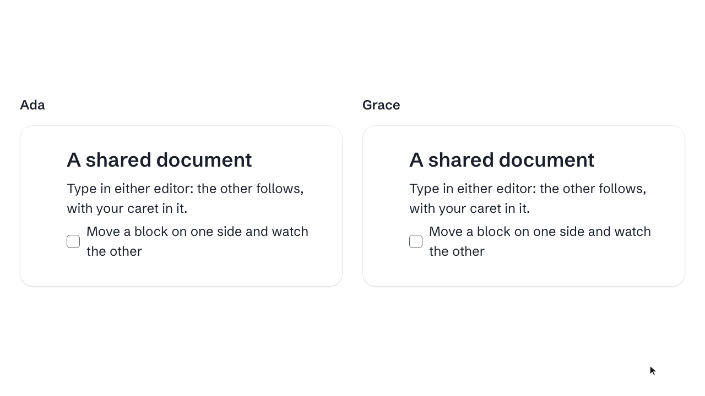
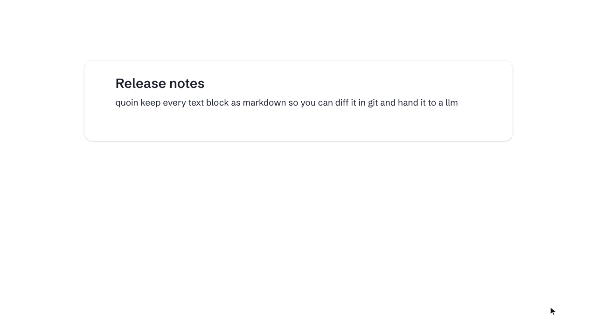

# Quoin

**Blocks on screen. Markdown on disk.**

Quoin is a rich markdown editor and block editor for React. Every text block stays readable markdown inside a typed array you hold in your own state; images, files, code, dividers, tables and the catalogue blocks are typed data beside them. Writers get live formatting, a slash menu, drag handles, real-time co-editing and AI that writes into the page; you get a document you can save, diff in git or hand to an LLM without a conversion step.

[](https://www.npmjs.com/package/quoin-editor) [](https://github.com/AmineSeboui/quoin-editor/actions/workflows/ci.yml) [](LICENSE)

[Home](https://quoincloud.com) | [Docs](https://quoincloud.com/docs/editor/getting-started) | [Live demo](https://amineseboui.github.io/quoin-editor/playground/) | [Changelog](CHANGELOG.md)



- **Live formatting, markdown on disk.** Type `**bold**` or `# ` and see bold text or a heading; the block stores the markdown. Blocks you never edit are never rewritten.
- **Typed blocks you control like an input.** A document is `QuoinBlock[]`, plain JSON, passed as `blocks` and returned through `onChange`, so saving, versioning and validation stay in your code.
- **Notion-style UI included, MIT.** Slash menu, bubble toolbar, block menu, drag handles, a mobile toolbar and a shortcuts dialog, with no account and no paid tier.
- **Custom blocks as plain React.** `defineBlock` takes an editor, a preview, or both, as React components; no schema language to learn.
- **Accessible, with tested keyboard and screen reader support.** In CI, axe runs over the canvas and its menus in light and dark mode, a document is written with the keyboard alone, and moves and deletions are announced. [What is not checked yet](https://quoincloud.com/docs/editor/accessibility#what-is-not-checked-yet).

## Write together, with AI



**Real-time collaboration.** Each person sees the other's typing, ticked tasks and moved blocks arrive as they happen, with a named caret showing where they are. Quoin syncs through your own Yjs provider, and comment threads stay anchored to the text they discuss. [Try it live](https://amineseboui.github.io/quoin-editor/collaboration/), or let [Quoin Cloud](https://quoincloud.com) host the server the provider talks to.



**AI that writes into the document.** Select text and ask AI to fix, rewrite, shorten, translate or continue it. The answer streams in as markdown beside the original, and one click accepts or discards it, in a single undo step. Quoin never calls a model: you pass it a stream from the one you use (the recording answers from the demo's simulated model). [Try it live](https://amineseboui.github.io/quoin-editor/ai/)

## Install

```bash
npm install quoin-editor
```

React 18.2 or 19, TypeScript 5.4 or later. Tailwind is optional, v3 and v4 both work. The npm tarball is about 1 MB packed, under 5 MB unpacked: ESM and CommonJS builds, and sourcemaps for the ESM one that leave out the source text. A page loads only the entries it imports.

## Quickstart

```tsx
import { useState } from 'react';
import { BlockCanvas, type QuoinBlock } from 'quoin-editor';
import 'quoin-editor/styles.css';

export function Editor() {
  const [blocks, setBlocks] = useState<QuoinBlock[]>([]);
  return <BlockCanvas blocks={blocks} onChange={setBlocks} />;
}
```

What `onChange` hands you, and what you store:

```json
[
  { "id": "a1", "type": "MARKDOWN", "data": { "markdown": "# Release notes" } },
  { "id": "b2", "type": "MARKDOWN", "data": { "markdown": "- Faster **paste**" } },
  { "id": "c3", "type": "CALLOUT", "data": { "tone": "tip", "body": "Back up first." } }
]
```

## What ships

| Entry | What it adds |
| --- | --- |
| `quoin-editor` | The canvas: text, lists, tasks, quotes, callouts, toggles, dividers, code, images and files, with every menu and toolbar |
| `quoin-editor/table`, `/embed`, `/math`, `/diagram`, `/toc`, `/mention`, `/emoji`, `/find`, `/stats` | Opt-in features, each its own entry; `quoin-editor/catalogue` adds them all |
| `quoin-editor/highlight` | Syntax colouring for code blocks, in every language the picker offers, fetched on demand |
| `quoin-editor/source` | The document as the markdown it is stored as, read only, beside or below the canvas |
| `quoin-editor/yjs`, `/presence` | Real-time co-editing through your own Yjs provider, and collaborators' carets |
| `quoin-editor/comments` | Comment threads anchored to text, kept in your store |
| `quoin-editor/ai` | Your model's answers streamed into the document; Quoin never calls a model |
| `quoin-editor/view`, `/diff`, `/docx` | Server rendering with no hooks, a diff of two versions, a Word export |
| `quoin-editor/locale-ar`, `/locale-de`, `/locale-es`, `/locale-fr`, `/locale-ja`, `/locale-pt`, `/locale-zh` | Every string the editor shows, in that language |
| `quoin-editor/headless`, `/engine` | The editor without the canvas UI, and the engine alone with no React |

## Why Quoin

Each competitor cell links to the page that shows it; the Tiptap UI cell also draws on the review in [#73](https://github.com/AmineSeboui/quoin-editor/issues/73) (2026-10-12).

| Feature | Quoin 2.0 | Tiptap 3 | BlockNote | Editor.js | Lexical | Plate |
| --- | --- | --- | --- | --- | --- | --- |
| Stored document | Block array, markdown per text block | [JSON, or HTML][tt-store] | [Block JSON][bn-formats] | [JSON][ej-repo] | [Editor state, as JSON][lx-intro] | [Slate JSON][pl-docs] |
| Markdown | The storage format | [`@tiptap/markdown`, an early release][tt-md] | [Export and import, documented as lossy][bn-formats] | [Community plugin][ej-awesome] | [`@lexical/markdown`, in and out][lx-md] | [`@platejs/markdown`, in and out][pl-md] |
| Notion-style UI | Included, MIT | [MIT menus and drag handle][tt-review]; [Notion-like template on a paid plan][tt-notion] | [Included][bn-home] | [Toolbox and inline toolbar][ej-repo] | [None; you draw it][lx-intro] | [MIT components][pl-repo]; [Notion-like set on a paid licence][pl-pro] |
| Licence | MIT | [MIT core, paid Pro extensions][tt-repo] | [MPL-2.0, `xl-*` packages GPL-3.0 or commercial][bn-repo] | [Apache-2.0][ej-repo] | [MIT][lx-repo] | [MIT, with paid Plus components][pl-pro] |
| Real-time collaboration | Yjs, opt-in entry | [Yjs][tt-collab] | [Yjs][bn-collab] | [On its roadmap, in progress][ej-repo] | [Yjs][lx-collab] | [Yjs][pl-yjs] |
| Comments | Opt-in, your store | [Paid plan][tt-comments] | [Built in, on Yjs or a thread store][bn-comments] | [Community plugin][ej-awesome] | [None shipped; a playground example][lx-repo] | [`@platejs/comment`, as text marks][pl-comment] |
| Localization | Seven packs, every string | [None shipped; the UI is yours][tt-ui] | [24 locales built in][bn-i18n] | [An i18n API; you bring the words][ej-i18n] | [None shipped; it draws no UI][lx-repo] | [None shipped; the UI is yours][pl-docs] |
| Framework | React | [React, Vue, Svelte, plain JavaScript and more][tt-install] | [React, or vanilla JS with your own UI][bn-vanilla] | [Plain JavaScript][ej-start] | [Any, with React bindings][lx-repo] | [React][pl-repo] |

Sources, checked on 2026-11-05: Tiptap [persistence][tt-store], [markdown][tt-md], [Notion-like template][tt-notion], [repository][tt-repo], [collaboration][tt-collab], [comments][tt-comments], [install][tt-install], [UI components][tt-ui]; BlockNote [home][bn-home], [formats][bn-formats], [repository][bn-repo], [collaboration][bn-collab], [comments][bn-comments], [getting started][bn-start], [vanilla JS][bn-vanilla], [localization][bn-i18n]; Editor.js [home][ej-home], [repository][ej-repo], [getting started][ej-start], [awesome-editorjs][ej-awesome], [i18n][ej-i18n]; Lexical [docs][lx-intro], [repository][lx-repo], [markdown][lx-md], [collaboration][lx-collab]; Plate [docs][pl-docs], [repository][pl-repo], [markdown][pl-md], [collaboration][pl-yjs], [comments][pl-comment], [Plate Plus][pl-pro].

[tt-store]: https://tiptap.dev/docs/editor/core-concepts/persistence
[tt-md]: https://tiptap.dev/docs/editor/markdown
[tt-review]: https://github.com/AmineSeboui/quoin-editor/issues/73
[tt-notion]: https://tiptap.dev/docs/ui-components/templates/notion-like-editor
[tt-repo]: https://github.com/ueberdosis/tiptap
[tt-collab]: https://tiptap.dev/docs/editor/extensions/functionality/collaboration
[tt-comments]: https://tiptap.dev/docs/comments/getting-started/overview
[tt-install]: https://tiptap.dev/docs/editor/getting-started/install
[bn-home]: https://www.blocknotejs.org/
[bn-formats]: https://www.blocknotejs.org/docs/foundations/supported-formats
[bn-repo]: https://github.com/TypeCellOS/BlockNote
[bn-collab]: https://www.blocknotejs.org/docs/features/collaboration
[bn-comments]: https://www.blocknotejs.org/docs/features/collaboration/comments
[bn-start]: https://www.blocknotejs.org/docs/getting-started
[bn-vanilla]: https://www.blocknotejs.org/docs/getting-started/vanilla-js
[ej-home]: https://editorjs.io/
[ej-repo]: https://github.com/codex-team/editor.js
[ej-start]: https://editorjs.io/getting-started
[ej-awesome]: https://github.com/editor-js/awesome-editorjs
[tt-ui]: https://tiptap.dev/docs/ui-components/components/overview
[bn-i18n]: https://www.blocknotejs.org/docs/features/localization
[ej-i18n]: https://editorjs.io/i18n/
[lx-intro]: https://lexical.dev/docs/intro
[lx-repo]: https://github.com/facebook/lexical
[lx-md]: https://lexical.dev/docs/packages/lexical-markdown
[lx-collab]: https://lexical.dev/docs/collaboration/react
[pl-docs]: https://platejs.org/docs
[pl-repo]: https://github.com/udecode/plate
[pl-md]: https://platejs.org/docs/markdown
[pl-yjs]: https://platejs.org/docs/yjs
[pl-comment]: https://platejs.org/docs/comment
[pl-pro]: https://pro.platejs.org

## Learn more

- [The controlled contract](https://quoincloud.com/docs/editor/contract): loading, autosave, discarding, undoing a deletion
- [Adopting existing documents](https://quoincloud.com/docs/editor/adoption): what markdown files and HTML lose on the way in, ids that last, the way back out
- [Theming](https://quoincloud.com/docs/editor/theming): `--quoin-` tokens, dark mode, cascade layers, Tailwind
- [Custom blocks](https://quoincloud.com/docs/editor/custom-blocks) and [uploads](https://quoincloud.com/docs/editor/uploads)
- [Extensions](https://quoincloud.com/docs/editor/extensions): every opt-in feature, and writing your own
- [Collaboration](https://quoincloud.com/docs/editor/collaboration), [comments](https://quoincloud.com/docs/editor/comments) and [AI](https://quoincloud.com/docs/editor/ai)
- [Server rendering](https://quoincloud.com/docs/editor/server-rendering): read-only, `QuoinView`, `QuoinDiff`, `toDocx`
- [Accessibility](https://quoincloud.com/docs/editor/accessibility): what each test suite checks, and what it does not yet
- [FAQ](https://quoincloud.com/docs/editor/faq): the package name, stability, React versions, and [upgrading to 2.0](MIGRATION.md#migrating-from-1x-to-20)

## Sponsors

Quoin is MIT, with no paid tier and nothing held back behind a licence. It is built and maintained by one person. [Sponsoring it](https://github.com/sponsors/AmineSeboui) pays for the time that keeps issues answered and releases going out.

No sponsors yet. Yours would be the first name here.

## The name

A quoin is the wedge a letterpress printer tightens to lock blocks of type into the frame, so nothing moves while the page is printed. Quoin does the same for blocks of markdown.

## Licence

MIT. Copyright (c) 2026 Amine Sboui. See [LICENSE](LICENSE).
